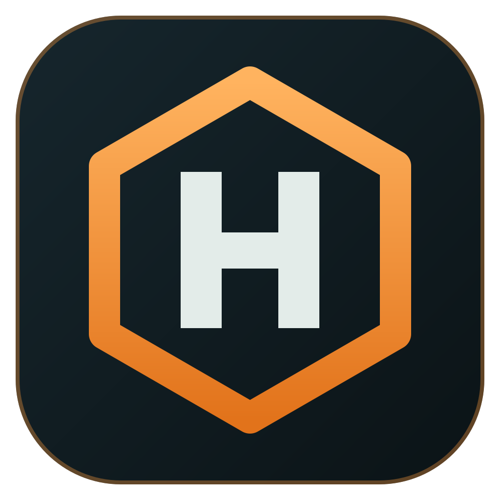

<div align="center">



# HML

**Haro's Mod Loader: a desktop mod manager for Thunderstore, Nexus Mods and GitHub.**

Pick a game, keep separate mod profiles, and start it modded or vanilla with one click.

[](https://github.com/darkharasho/hml/releases/latest)
[](https://github.com/darkharasho/hml/releases)
[](https://github.com/darkharasho/hml/actions/workflows/release.yml)

[](LICENSE)

[**Download**](#download) · [**Features**](#features) · [**Getting started**](#getting-started) · [**Linux and Proton**](#linux-and-proton) · [**Development**](#development)

</div>

---

HML works like [r2modman](https://github.com/ebkr/r2modmanPlus), with a modern interface and two extra sources. Besides Thunderstore, it browses and installs mods from **Nexus Mods**. Paste a **GitHub repo URL** and HML installs the mod from the repo's latest release, then keeps it updated as new releases come out.

## Features

<table>
<tr>
<td width="50%" valign="top">

### 🎮 Games and profiles
- Every Thunderstore game, plus Nexus Mods games and any game folder you add yourself
- Finds your installed Steam games and their covers
- Separate profiles per game, each with its own mods and configs
- Drop a mod `.zip` onto the list to install it by hand
- **Start modded** or **Start vanilla** from the launch bar

</td>
<td width="50%" valign="top">

### 📦 Thunderstore
- Search, sort and filter a game's whole catalog
- Installs dependencies for you
- Shows each mod's README, changelog and dependencies
- Update one mod or all of them at once

</td>
</tr>
<tr>
<td valign="top">

### 🧩 Nexus Mods
- Browse and search Nexus mods for a game, inside HML
- Premium accounts download directly
- Free accounts use the site's **Mod Manager Download** button, and HML picks it up
- Your API key is kept in your system's secure storage

</td>
<td valign="top">

### 🐙 GitHub releases
- Paste a repo URL to install its latest release zip
- Opt in to prereleases per mod
- Updates arrive automatically when the repo publishes a new release
- Also used to install and switch BepInEx builds for your own games

</td>
</tr>
<tr>
<td valign="top">

### 🔗 Share codes
- Export a profile as a short code or a `.hml` file
- Importing rebuilds the same mod list at the same versions
- Covers Thunderstore, Nexus and GitHub mods
- Imports r2modman codes and `.r2z` files too

</td>
<td valign="top">

### ⚙️ Takes care of itself
- HML updates itself from GitHub releases
- Detects a game folder's engine, exe and loader
- Backs up a hand-installed BepInEx before replacing it
- On Linux, sets up Proton for you (see [below](#linux-and-proton))

</td>
</tr>
</table>

## Download

Get the latest build from the [**Releases page**](https://github.com/darkharasho/hml/releases/latest).

| Platform | File |
| --- | --- |
| **Windows** | `hml-<version>-setup.exe` |
| **macOS** (Apple Silicon) | `hml-<version>-mac-arm64.dmg` |
| **macOS** (Intel) | `hml-<version>-mac-x64.dmg` |
| **Linux** | `hml-<version>.AppImage` |

After it's installed, HML updates itself. On Linux, the AppImage is the only format that can update itself.

> [!TIP]
> On Linux, make the AppImage executable first: `chmod +x hml-*.AppImage`.

## Getting started

1. **Pick a game.** Choose it from the grid, or add any game with **Add a game by folder…**.
2. **Choose a profile.** Each game starts with a default profile. Add more from the sidebar to keep different mod setups apart.
3. **Add mods.** Browse Thunderstore or Nexus Mods, click **Add from GitHub** and paste a repo URL, or drop a mod `.zip` onto the mod list.
4. **Start modded.** HML installs the game's loader and copies the profile's mods into place before the game starts.

To use Nexus Mods, open **Settings** and paste your [personal API key](https://www.nexusmods.com/users/myaccount?tab=api).

## Linux and Proton

On Linux, Windows games run through Proton. **Start modded** sets up the game's Proton prefix so BepInEx loads. You don't need to set Steam launch options or close Steam. HML keeps a backup of the prefix file it changes (`user.reg.hml-backup`).

> [!NOTE]
> Proton creates a game's prefix the first time the game runs. If you've never started a game, start it once (vanilla is fine) before starting it modded.

## Development

HML is built with Electron, React, TypeScript, Vite and Tailwind CSS.

```bash
npm install
npm run dev        # start the app with hot reload
npm test           # unit tests (vitest, 2 workers)
npm run lint       # eslint
npm run typecheck  # tsc for main and renderer
npm run build      # typecheck and build
```

To package an installer for your own platform, use `npm run build:linux`, `build:win` or `build:mac`.

<details>
<summary><b>Project layout</b></summary>

```
src/
  main/        Electron main process
    catalog/     game catalog and Thunderstore ecosystem data
    thunderstore/, nexus/, github/   mod sources
    profiles/, install/, deploy/     profiles, installs, copying mods into the game
    launch/, steam/                  launching, Steam and Proton
    custom/                          games you add yourself
    share/                           profile export and import
  preload/     the IPC bridge to the renderer
  renderer/    React UI
worker/        Cloudflare Worker that stores share codes
tests/         vitest suites
```

</details>

Releases are cut from tags. See [docs/RELEASING.md](docs/RELEASING.md).

---

<div align="center">
<sub>Made by <a href="https://github.com/darkharasho">darkharasho</a>. <a href="LICENSE">MIT licensed</a>. Not affiliated with Thunderstore, Nexus Mods or Valve.</sub>
</div>
